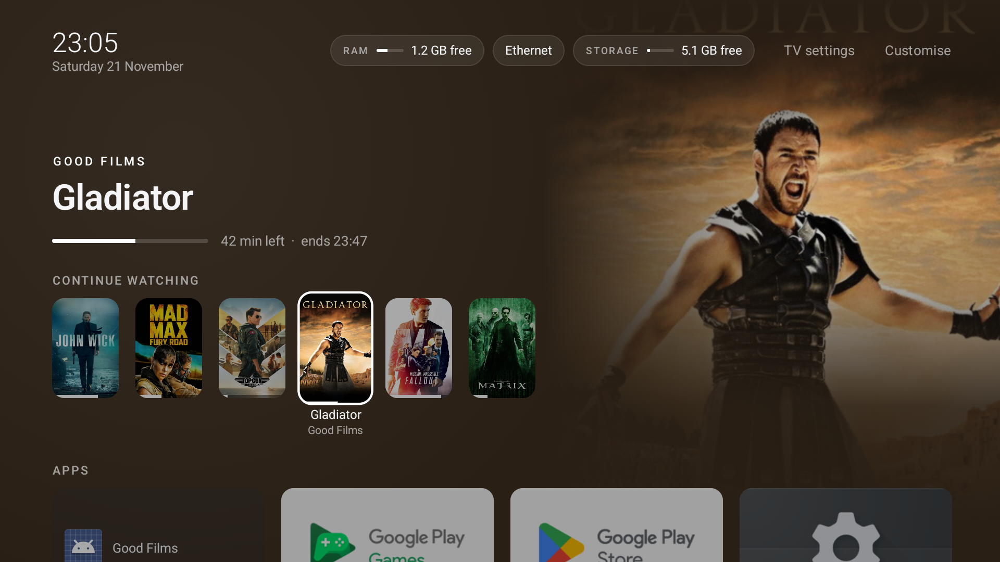
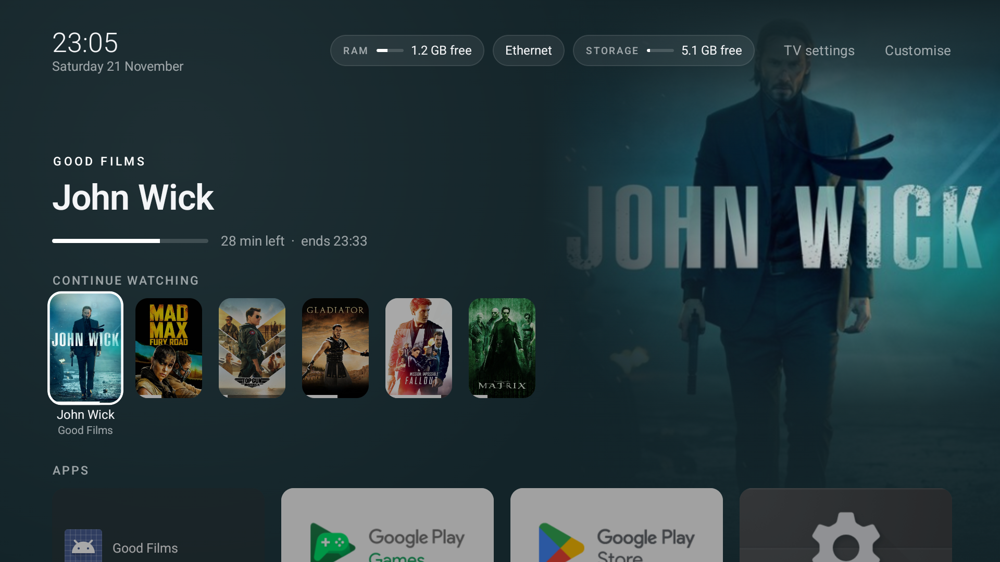
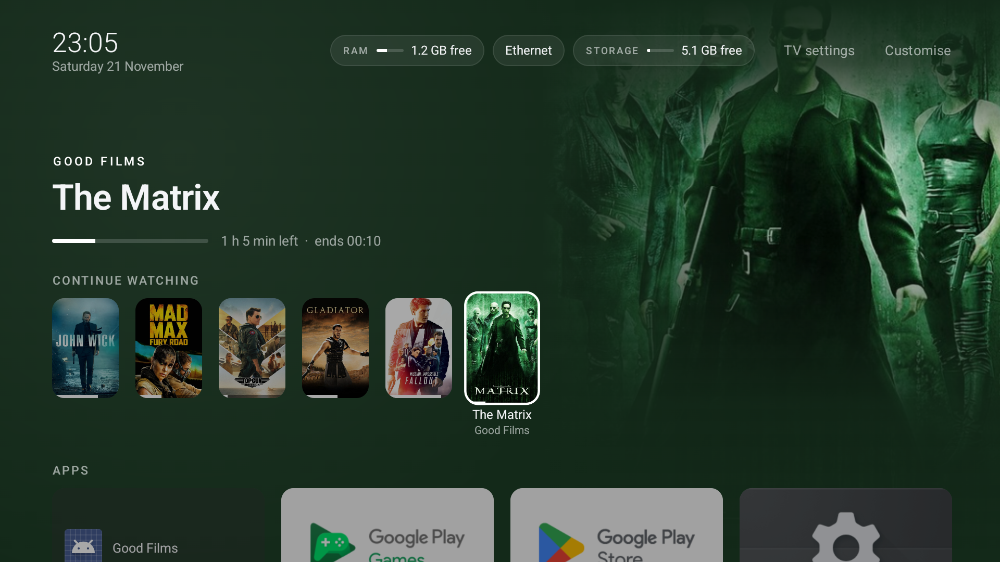
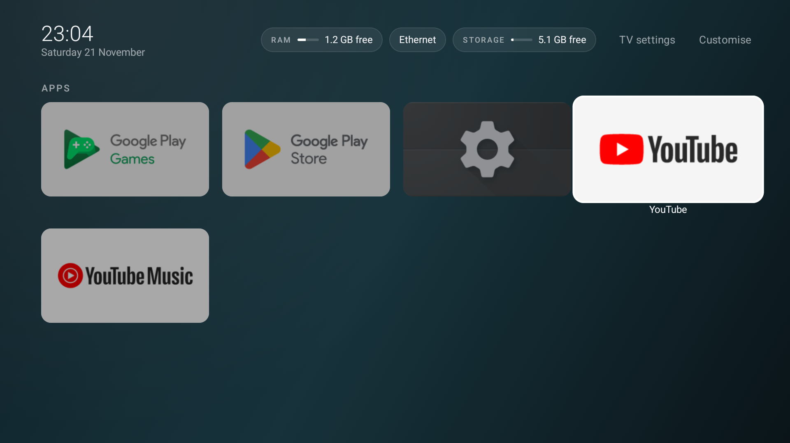
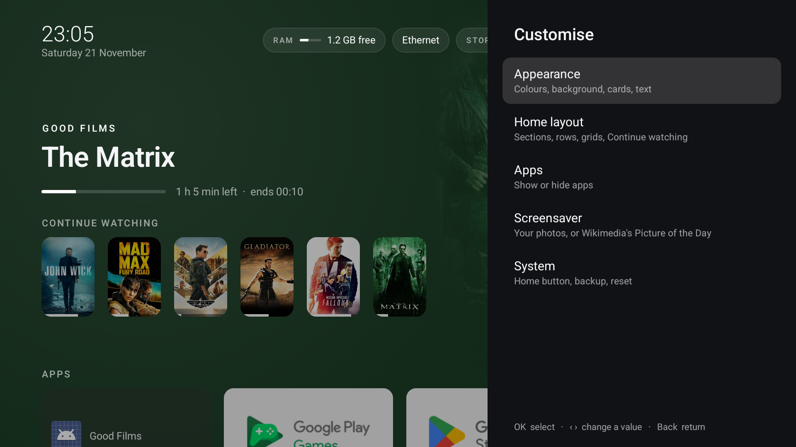
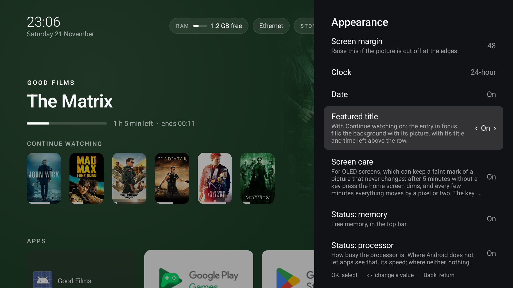
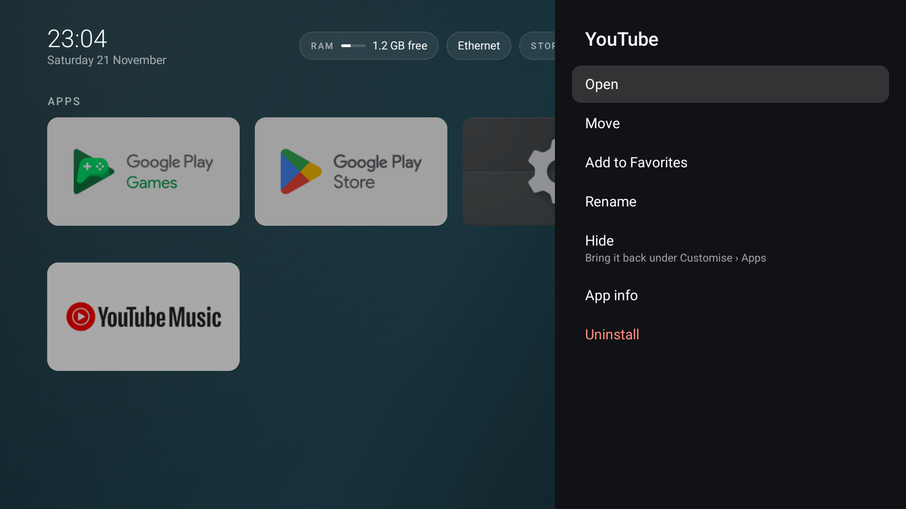

# Slate

A minimal home screen for Android TV and Google TV. No ads, no recommendations, no tracking.
Everything about how it looks and what it shows is yours to change.

Slate uses the network for two things only, each off until you switch it on: poster images for the
optional Continue watching row, and the screensaver's Picture of the Day from Wikimedia Commons
(see below).



With Continue watching on, the title in focus fills the background, in a colour taken from its
poster. Move down to the apps and your wallpaper is back.

| | |
|---|---|
|  |  |



| Customise | Appearance | App options (hold OK) |
|---|---|---|
|  |  |  |

<sub>The film posters in these screenshots belong to their respective owners and are shown only
to illustrate the row; they are not part of Slate. The entries were published by the test app in
`tools/test-apps/probe2`, with poster images served by TMDB. The apps screenshot was taken with
that test app hidden, which also takes its entries out of Continue watching.</sub>

## Install

Slate is installed from a computer over ADB; there is no store listing. The steps below take a
few minutes and need no build.

**You need**

- A computer on the same network as the TV, with `bash`, `git` and `curl` (Linux, macOS, or WSL
  on Windows).
- `adb`, from the [Android platform-tools](https://developer.android.com/tools/releases/platform-tools).
  Unpack the download in your home folder or in Downloads and the script finds it there; it
  also finds Android Studio's copy and any `adb` already on your PATH. Kept somewhere else,
  tell the script where: `export ADB=/path/to/platform-tools/adb`.

**Steps**

1. Get the script:

   ```bash
   git clone https://github.com/borexola/slate-launcher.git
   cd slate-launcher
   ```

2. On the TV, switch on debugging: Settings > System > About, press "Android TV OS build" seven
   times, then turn on network (or USB) debugging under Developer options. Note the TV's IP
   address (Settings > Network & Internet).

3. Connect, then download and install the latest release. The TV asks you to allow the computer
   the first time.

   ```bash
   scripts/slate.sh connect <tv-ip>
   scripts/slate.sh update
   ```

   With more than one device attached (a second TV, an emulator), every command says which one
   it is using. Choose with `export ANDROID_SERIAL=<tv-ip>:5555`; `connect` reminds you when
   the terminal is still pointed at another device.

4. Make Slate the home screen. Have the TV on and awake for this.

   ```bash
   scripts/slate.sh takeover
   ```

5. Press Home on the remote. Slate opens; **Customise** in the top bar has every setting.

To go back to the stock home screen run `scripts/slate.sh restore`, and to remove Slate
`scripts/slate.sh uninstall` (see [Getting out again](#getting-out-again)).

Shield, wireless-debugging-only devices and TVs with a manufacturer's home screen are covered
under [Install in detail](#install-in-detail).

### Updates

New versions are published as [releases](https://github.com/borexola/slate-launcher/releases).
To hear about them, use **Watch > Custom > Releases** on the repository page; GitHub then
e-mails you each time one comes out.

```bash
git pull                    # the script itself
scripts/slate.sh update     # the app on the TV; settings are kept
```

`update` downloads the latest release over https, checks it against the checksum published with
it, and installs it. It says so and does nothing when the TV already has the latest version.
Android itself only accepts an update signed with the same key as the Slate already installed,
so a copy you built yourself cannot be updated this way (and the other way round): `update`
tells you if that is the case and changes nothing.

### Building it yourself

Instead of step 3's `update`, build the app (see [Build](#build)) and run
`scripts/slate.sh install`, which installs the copy built on this computer. Keep to one of the
two ways on a given TV, because of the signing key.

## Build

Needs JDK 17 and the Android SDK (platform 35).

```bash
./gradlew assembleRelease
```

The APK lands in `app/build/outputs/apk/release/app-release.apk`.

**Signing.** The release is signed with the key described by
`~/.config/slate-launcher/keystore.properties` (or the file named in `SLATE_KEYSTORE_PROPERTIES`),
containing `storeFile`, `storePassword`, `keyAlias` and `keyPassword`. Android only accepts an
update signed with the same key as the installed app, so **back that folder up**. Without it the
build falls back to the shared Android debug key and prints a warning.

## Install in detail

On the TV: Settings > System > About > press "Android TV OS build" seven times, then turn on
network (or USB) debugging under Developer options. The TV asks you to allow the computer the
first time it connects.

On an NVIDIA Shield the same switches are under Settings > Device Preferences > About (press
"Build" seven times) and Settings > Device Preferences > Developer options > Network debugging.
The Shield's home screen is the Android TV one, which `takeover` knows.

Some newer devices only offer "Wireless debugging" with a pairing code. Pair once with
`adb pair <tv-ip>:<pairing-port>`, then give `connect` the address and port the TV shows:
`scripts/slate.sh connect <tv-ip>:<port>`.

```bash
scripts/slate.sh connect <tv-ip>
scripts/slate.sh install
scripts/slate.sh takeover
```

`takeover` first checks that Slate starts, stays running and is showing (so have the TV on), then
switches the stock home screen off so Android has only Slate to send the Home button to. That is what stops it snapping back:
there is nothing left to snap back to. If Android still does not send Home to Slate afterwards,
the script switches the stock home screen back on by itself and tells you.

`takeover` knows the Google home screens (Google TV, Android TV). On a device with a
manufacturer's own home screen, or one that refuses to switch its home screen off, it says so,
and the fallback is the way to go:

```bash
scripts/slate.sh guard-on
```

This turns on a small accessibility service that catches the Home button and returns to Slate
whenever the device's own home screen appears. It reads no screen content, ignores launchers you
installed yourself, and steps aside during device setup, on a locked screen, and if Slate fails
to appear.

When `takeover` or `restore` has changed something, it waits fifteen seconds before going on.
Android only saves which packages are switched off, and which home screen to use, some seconds
after being told, and a reboot or power cut before that undoes the change, so let the script
finish before unplugging anything.

A system update can switch the stock home screen back on; run `takeover` again if that happens.

### Getting out again

| Command | What it does |
|---|---|
| `scripts/slate.sh status` | Shows what the Home button opens and what is switched off |
| `scripts/slate.sh restore` | Stock home screen back on, the Home button back to the home screen it opened before `takeover`, guard off, and the screensaver back to the one used before `screensaver-on`. (If that was a launcher you installed yourself and it cannot be confirmed as the same installation, for instance because it was removed and installed again, it is named and left for you to confirm) |
| `scripts/slate.sh rescue` | `restore`, and wipes all of Slate's data: settings, wallpaper, artwork, screensaver photos and any exported settings not yet copied off the TV. For when Slate will not start |
| `scripts/slate.sh uninstall` | `restore`, then removes Slate. Refuses unless a home screen that is part of the system is switched on; add `--anyway` to hand over to a launcher you installed yourself. With no other home screen at all it always refuses, and also while Home does not yet open a system home screen and the Google TV setup helper is switched on (Android could hand Home to the helper) |

**Never uninstall Slate any other way while the stock home screen is switched off**: the TV would
be left with no home screen. Keep debugging enabled on the TV for as long as Slate is your home
screen, because ADB is the way back if something goes wrong. Debugging over the network is not
encrypted on older Android versions, so only use it on a network you trust.

If Slate dies three times within five minutes while it is on screen or starting up (it crashes,
or the system kills it), the next start is in **safe mode**: your settings are set aside (not deleted), no
wallpaper or app artwork is loaded so cards show names only, and a note on the home screen says
so. That is enough to get in, change what was wrong or uninstall an app, and carry on.
Customise > System has the options: remove custom wallpaper and artwork, and leave safe mode with
or without bringing the settings back.

Settings that were set aside are kept until you restore them. If safe mode comes round more than
once, each time adds a copy of its own instead of replacing the one before. Six are kept; beyond
that the second oldest makes room, so the very first and the most recent ones stay. Restoring
brings back the most recent copy. For as long as any copy remains (because you left safe mode
without restoring, or because there are earlier ones), "Restore earlier settings" is offered
under Customise > System and brings back the most recent of those left. It replaces the settings you have at
that point, so it asks twice. Being replaced by an update, and power cuts, do not count towards
the three.

## Using it

| Remote | Does |
|---|---|
| OK | Open the app |
| Hold OK, or Menu | App options: move, add to a section, rename, hide, uninstall |
| Home, while on Slate | Close any panel and go back to the top |
| Left / Right, in a panel | Change the value on the highlighted line. OK moves on to the next value and starts over after the last |

Coming back to Slate from an app leaves the screen where it was.

**Customise** in the top bar opens every setting. Changes apply live behind the panel.
**TV settings** next to it opens Android's own settings.

### Continue watching

Customise > Home layout > Continue watching adds a row at the top with what your apps report as
in progress or up next: the same list the stock home screen uses. It is off until you switch it
on, and Android asks first whether Slate may read that list (or allow it from a computer with
`scripts/slate.sh watch-next`).

- What appears depends on the apps: each decides what it reports. Up to six entries per app and
  sixteen in all are shown, most recently watched first.
- Choosing an entry opens it in its app. Slate only ever starts the app that reported the entry,
  never something else the entry might ask for.
- Poster images are fetched from the addresses the apps give, over https only, and only for apps
  that may use the network themselves. The request carries nothing about you or the TV beyond
  what any connection reveals (its address). JPEG and PNG posters are shown; for anything else
  the title is shown instead.
- Nothing is read or fetched in safe mode, or while the row is switched off.
- **Featured title** (Customise > Appearance, on by default): the entry in focus fills the
  background with its poster, in a colour taken from it, with its title, episode and time left
  ("34 min left · ends 21:57") above the row. Moving down to the apps brings the wallpaper back.
  The bigger picture is made from the poster already fetched; nothing else is downloaded for it.

### Top bar

The time and date are at the left. Next to the buttons, small chips show free memory, the
processor, free storage and the connection (Wi-Fi with its strength, Ethernet, or offline). Each
can be switched off under Customise > Appearance. They are read every two seconds while the home
screen is showing, and never sent anywhere. Since Android 8 apps may not see how busy the
processor is; on such TVs the chip shows its current speed instead, and nothing where Android
hides that too.

### Screen care (OLED)

OLED screens can keep a faint mark of a picture that stays put for hours, and a home screen is
such a picture. With Customise > Appearance > Screen care on (the default), the home screen dims
after 5 minutes without a key press, and every 3 minutes everything on it, the featured picture
included, moves by a pixel or two round a small circle, too little to notice. The key press that
wakes a dimmed screen only wakes it. For longer idle times, let the TV's screensaver take over
(Slate's own, below, keeps changing pictures).

### Screensaver

Slate has its own screensaver: a slideshow of your photos, of Wikimedia Commons' Picture of the
Day, or both. Customise > Screensaver sets where the pictures come from, how long each one stays
(5 seconds to 10 minutes), shuffle, and a clock (in the style chosen under Appearance).

Make it the TV's screensaver from a computer (on Google TV the TV's own settings usually do not
offer screensavers from other apps):

```bash
scripts/slate.sh screensaver-on
scripts/slate.sh screensaver-off   # puts back the one used before
```

`screensaver-on` keeps a note on the TV of the screensaver used before; `screensaver-off`,
`restore` and `uninstall` put that one back. If you changed the screensaver on the TV in the
meantime, they leave your choice alone. On TVs whose settings list screensavers from other
apps, "Slate pictures" can also be chosen there. Android starts it after the idle time set on
the TV; any button ends it. Whether Google TV accepts a screensaver set this way has not been
checked on a real Google TV yet.

**Your photos.** From a computer:

```bash
scripts/slate.sh photos add ~/Pictures/tv     # the .jpg, .jpeg and .png files in that folder
scripts/slate.sh photos clear                 # removes the photos uploaded this way
```

Subfolders are not included. A photo with the same name as one uploaded before replaces it.
On a TV with a file picker, Customise > Screensaver > Add photos copies pictures from there
(at most 500), and the same page removes them again. Most TVs have no file picker; the TV
says so. Photos follow the same rules as the wallpaper (JPEG or PNG up to 16 MB and about 25
megapixels, cleaned before use; see Images below). Pictures close to the screen's shape fill it;
others are shown whole on black.

**Picture of the Day.** Off until you choose it. Slate then asks Wikimedia Commons, without any
key or account, for the pictures of the last seven days and keeps them on the TV, so the
screensaver still has them when the TV is offline. It only contacts `commons.wikimedia.org`
(which picture, its author and licence) and `upload.wikimedia.org` / `thumb.wikimedia.org`
(the picture, 1920 pixels wide), over https with the same safeguards as the posters, about
once an hour and only while the screensaver runs or right after you choose this source. Each
picture shows its title, author and licence. Wikimedia limits how often one address may ask,
so on a busy network pictures may arrive an hour or so later.

Nothing is shown or fetched in safe mode.

## Customising from a computer

All settings live in one JSON file.

```bash
# on the TV: Customise > System > Export settings
scripts/slate.sh pull-config
# edit slate-config.json
scripts/slate.sh push-config
# on the TV: Customise > System > Import settings
```

Colours accept any `#RRGGBB` value, not only the presets offered on the TV. Values out of range
are pulled back into range on import, and a file that cannot be read is rejected with the reason.

Images:

```bash
scripts/slate.sh wallpaper picture.jpg
scripts/slate.sh icon com.example.app artwork.png
```

- **Wallpaper** accepts JPEG and PNG up to 16 MB and about 25 megapixels (12 for a progressive
  JPEG). A 4K photo as JPEG is far inside that; as PNG it can exceed the 16 MB. Select it under
  Customise > Appearance > Background > Wallpaper. If you also pick an image on the TV, whichever
  was set last is used. Photos are shown the right way up.
- **Icon** replaces one app's artwork. The file must be named .png, up to 2 MB and 4 megapixels.
  An image clearly wider than it is tall (from about 4:3) is cropped to a 16:9 banner; anything
  else is used as an icon. Remove it again with
  `adb shell rm /sdcard/Android/data/app.slate.launcher/files/icons/<package>.png`.
- Not accepted: interlaced or 16-bit PNGs, WebP, HEIC and other formats, and unusual kinds of
  JPEG (lossless, arithmetic-coded, more than 8 bits). An image outside the limits is ignored
  rather than shown.
- Extras stored inside an image file (colour profiles, embedded thumbnails, HDR gain maps, text)
  are discarded, so colours of wide-gamut photos may look slightly flatter than in a photo viewer.
- New images show up the next time you return to the home screen.
- Open Slate on the TV once before uploading anything, so that its folder exists.

These files, and the exported settings, live in Slate's folder on shared storage
(`/sdcard/Android/data/app.slate.launcher/files/`). On Android 10 and older, other apps with
storage permission can read and change that folder. Slate treats everything in it as untrusted:
images are reduced to their plain picture data and checked for type and size before the system
decodes them, then scaled down for use, and imported settings are validated.
